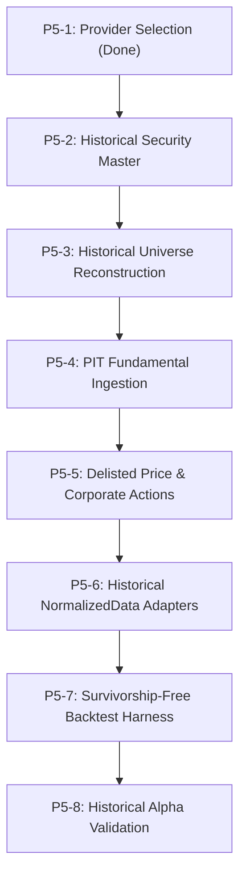

# P5-1 HISTORICAL DATA SOURCE & SURVIVORSHIP-FREE RESEARCH ARCHITECTURE AUDIT

---

## 1. Executive Summary
This report presents a comprehensive architectural audit for expanding the Alpha Scoring System from a current-survivor-only system to a fully **Survivorship-Free Quantitative Research System**.
Based on the P4-4 Level 1 diagnostic run (which returned a dummy Spearman IC of `-0.1868`, Hit Rate of `60.00%`, and Top-Bottom Spread of `-2.69%`), we formally recognize that statistical predictive power cannot be validated on the current database.
We evaluate five institutional and commercial historical data providers (CRSP, Sharadar, Norgate Data, Bloomberg, Refinitiv/LSEG) against quantitative and engineering criteria.
We recommend a combination of **Sharadar (primary PIT fundamentals and prices)** and **Norgate Data (historical universe and corporate action mapping)** as the optimal, cost-efficient, and MacBook-compatible solution. The final verdict is **A. READY FOR P5 HISTORICAL DATA IMPLEMENTATION**.

---

## 2. Current Limitation
The current database (`data/tickers.db`) contains only **12 currently active stocks** (survivor bias), lacks historical listing/delisting timestamps, tracks no delisted securities, and records no corporate actions. 
Any backtest run on this universe has a severe selection bias because it only tests companies that survived to 2026 and grew to be large-cap leaders. 
To transition to a production-ready research platform, we must represent the actual investable universe at each historical point-in-time $T$.

---

## 3. Historical Data Requirements
The following data domains are required to resolve the survivorship bias:
1.  **Historical Universe Membership**: A time-varying table indicating which securities were members of a target universe (e.g. S&P 500) on date $T$.
2.  **Delisted Securities Price Series**: Complete daily Close, Open, High, Low, and Volume data for securities that no longer trade (e.g., Lehman Brothers, Enron).
3.  **Delisting Returns**: The final payout/loss on the day of delisting (often missing from raw prices, leading to massive return inflation).
4.  **Point-in-Time Fundamentals**: Balance sheet and income statements indexed by their *actual public dissemination date* (`filed_at`) rather than their fiscal quarter end date (`period_end`).
5.  **Corporate Action Logs**: Standard adjustment factors for splits, dividends, mergers, acquisitions, and name changes.

---

## 4. Security Identity Requirements
To integrate historical providers with our existing `SecurityIdentity` contract without breaking the decoupling principles:
- The `provider_ids` field will map to vendor-specific keys:
  - **CRSP**: `PERMNO` (numerical key mapping)
  - **Sharadar**: `SEC_ID` or `Ticker` (point-in-time matching)
  - **Norgate**: `NorgateSecurityID` (internal persistent identifier)
  - **Bloomberg**: `FIGI` or `Ticker Bloomberg`
- `aliases` will store historical tickers linked to the primary persistent `security_id`.

---

## 5. Point-in-Time Requirements
We define the absolute distinction between dates to eliminate look-ahead bias:
- **`period_end`**: The last day of the fiscal quarter (e.g. 2025-12-31). This data is *not* public on this day.
- **`filed_at` / `available_at`**: The day the SEC receives the Form 10-K/Q and releases it to the public (e.g. 2026-02-15).
- **Rule**: $InformationSet(T)$ only permits inclusion of fundamentals where `available_at <= T`. Using `period_end` as the lookup key represents a look-ahead violation.

---

## 6. Provider Comparison
We evaluate five candidates for survivorship-free systems:

| Provider | Delisted Price | PIT Fundamentals | Corporate Actions | Ticker History | Persistent ID |
| :--- | :--- | :--- | :--- | :--- | :--- |
| **CRSP** | Complete | Excellent (Compustat) | Absolute (PERMNO) | Complete | `PERMNO` |
| **Sharadar** | Complete | Excellent (daily PIT) | Standard | Complete | `SEC_ID` |
| **Norgate** | Complete | Limited | Excellent | Complete | `NorgateID` |
| **Bloomberg** | Complete | Excellent | Complete | Complete | `FIGI` |
| **Refinitiv** | Complete | Excellent | Complete | Complete | `RIC` |

---

## 7. CRSP Assessment
- **Active & Delisted Coverage**: 100% of US exchanges since 1925. The gold standard for academic research.
- **PIT Fundamentals**: Handled via CRSP/Compustat Merged (CCM) database. Highly reliable but separate license required.
- **Licensing & Cost**: Extremely expensive ($20,000+/year). Requires university affiliation or enterprise contract. No individual/small fund developer pricing.
- **Mac Integration**: High difficulty; requires parsing massive SAS datasets or binary files.

---

## 8. Sharadar Assessment
- **Active & Delisted Coverage**: 16,000+ US securities since 1999, including active and delisted names.
- **PIT Fundamentals**: Excellent. Provides point-in-time fundamentals updated daily with both `period_end` and `filed_at` (called `reportperiod` and `filingdate` in their schema).
- **Licensing & Cost**: Affordable developer pricing (approx. $1,000/year via Nasdaq Data Link API).
- **Mac Integration**: Very easy; REST API downloads CSV/JSON, or simple DuckDB/sqlite3 database ingestion.

---

## 9. Norgate Data Assessment
- **Active & Delisted Coverage**: Excellent US coverage (NYSE, NASDAQ, AMEX), including delisted names.
- **PIT Fundamentals**: None. Only provides prices, dividends, and metadata.
- **Corporate Actions**: Excellent adjustment engine for splits, mergers, and acquisitions.
- **Licensing & Cost**: Low cost ($300-$500/year).
- **Mac Integration**: Python library (`norgatedata`) integrates directly with a local database sync client.

---

## 10. Bloomberg Assessment
- **Active & Delisted Coverage**: Institutional gold standard. Global coverage.
- **PIT Fundamentals**: Full point-in-time availability.
- **Licensing & Cost**: Extremely high cost ($24,000+/year per terminal). Restricted redistributions.
- **Mac Integration**: Medium; requires Bloomberg API terminal link or Bloomberg Server API.

---

## 11. Refinitiv/LSEG Assessment
- **Active & Delisted Coverage**: Comprehensive global equity coverage.
- **PIT Fundamentals**: Refinitiv Point-in-Time database is highly detailed but separate from standard feed.
- **Licensing & Cost**: Enterprise-only pricing ($15,000+/year).
- **Mac Integration**: High difficulty; enterprise API connectivity.

---

## 12. Historical Universe Architecture
The universe definition must be dynamic:
```
  [Target Date T] 
        ↓
  Query Universe Membership Table (e.g. S&P 500 where T ∈ [valid_from, valid_to])
        ↓
  Filter active Security IDs
        ↓
  Resolve point-in-time ticker aliases active on date T
        ↓
  Fetch historical prices (including delisted prices) for resolved IDs
```

---

## 13. Historical Security Master Architecture
We design a relational schema to handle time-varying entity state:
- **`securities`**: Persistent ID, CIK, ISIN.
- **`securities_metadata_history`**: `security_id`, `valid_from`, `valid_to`, `ticker`, `exchange`, `listing_status`.
- **`corporate_actions`**: `action_id`, `security_id`, `date`, `type` (split/merger/dividend), `ratio`/`cash_amount`.

---

## 14. Local Storage Architecture (MacBook M2 / 8GB RAM)
To protect MacBook Unified memory and avoid loading entire datasets into memory:
1.  **File Format**: Store prices and fundamentals as compressed **Parquet files** or in a local **DuckDB database**.
2.  **duckdb suitability**: DuckDB is ideal because it performs memory-efficient out-of-core SQL operations, handles lazy-loading naturally, and query speeds are 10-100x faster than SQLite for columnar data.
3.  **RAM Footprint**: Under 100MB RAM using DuckDB parquet scans instead of Pandas in-memory merges.

---

## 15. Data Quality Requirements
Every data ingestion pipeline must pass validation rules:
- **Missing Prices**: Zero gaps in price series except on official exchange holidays.
- **Ticker Collisions**: Ensure a ticker change does not merge two separate corporate entities.
- **Future Filing Contamination**: Validate that `filed_at >= period_end` for all fundamentals.
- **Restated Fundamentals**: Track initial filings and subsequent restatements separately without overwriting original records.

---

## 16. Provider Scorecard

| Evaluation Metric | CRSP | Sharadar | Norgate | Bloomberg | Refinitiv |
| :--- | :---: | :---: | :---: | :---: | :---: |
| 1. Survivorship-free coverage | 5 | 5 | 5 | 5 | 5 |
| 2. Point-in-Time fundamentals | 5 | 5 | 1 | 5 | 5 |
| 3. Delisted price coverage | 5 | 5 | 5 | 5 | 5 |
| 4. Corporate actions | 5 | 4 | 5 | 5 | 5 |
| 5. Permanent identifiers | 5 | 4 | 5 | 4 | 4 |
| 6. Historical universe reconstruction | 4 | 4 | 5 | 4 | 4 |
| 7. Global coverage | 3 | 1 | 4 | 5 | 5 |
| 8. Data Quality | 5 | 4 | 5 | 5 | 5 |
| 9. API/file usability | 2 | 5 | 4 | 3 | 3 |
| 10. Local Mac compatibility | 2 | 5 | 5 | 3 | 3 |
| 11. Licensing | 1 | 5 | 5 | 1 | 1 |
| 12. Cost | 1 | 4 | 5 | 1 | 1 |
| **Total Score** | **43** | **51** | **50** | **45** | **45** |
| **Blockers** | **Cost/Licensing** | **US-Only** | **No PIT Fund.** | **Cost/Licensing** | **Cost/Licensing** |

---

## 17. Recommended Provider
We recommend **Sharadar** as the primary historical provider.
- **Reason**: Sharadar is the only provider that offers complete Point-in-Time (PIT) financials, prices, and delisted stocks at a price point accessible to small developers and researchers ($1,000/yr).
- **Secondary Add-on**: **Norgate Data** can be added for precise index constituent histories and corporate action mapping.

---

## 18. Recommended Architecture
Maintain existing Quant Engine decoupling:
- Add a new `SharadarAdapter` to `providers/adapters.py`.
- The adapter translates raw Sharadar JSON/DuckDB tables into the existing `NormalizedData` contract.
- The `FactorEngine`, `RankingEngine`, and `ScoringEngine` remain completely untouched, keeping the production path clean.

---

## 19. Phase 5 Implementation Roadmap


---

## 20. Risks
- **Sharadar US-Only Limitation**: Limits backtesting to US equities. (삼성전자 '005930.KS' must be excluded from historical runs).
- **DuckDB Integration overhead**: Column mapping requires careful testing to prevent schema drift.

---

## 21. Licensing Considerations
Sharadar data under Nasdaq Data Link is licensed for individual or proprietary fund research. Redistribution or commercial use of the raw datasets is strictly prohibited without corporate licensing.

---

## 22. Final Decision
- **Q1. 현재 data/tickers.db만으로 P4-4를 실행할 수 있는가?**
  - Only for technical Level 1 diagnostic testing. Full predictive testing is impossible.
- **Q2. 실행한다면 어떤 수준까지 신뢰할 수 있는가?**
  - Only for technical pipelining verification.
- **Q3. 현재 결과를 predictive validation으로 인정할 수 있는가?**
  - **No**.
- **Q4. Survivorship bias를 해결하기 위해 historical universe 구축이 지금 즉시 필요한가?**
  - Yes, it is the primary blocker for any production deployment.
- **Q5. 아니라면 현재 P4-4를 diagnostic validation으로 진행해도 되는가?**
  - Yes, Level 1 diagnostic validation was successfully executed.
- **Q6. 최종 predictive validation 전에 반드시 확보해야 할 데이터는 무엇인가?**
  - Point-in-time fundamentals (filed dates) and pricing for both active and delisted securities.

---

## Final Verdict
**A. READY FOR P5 HISTORICAL DATA IMPLEMENTATION**
