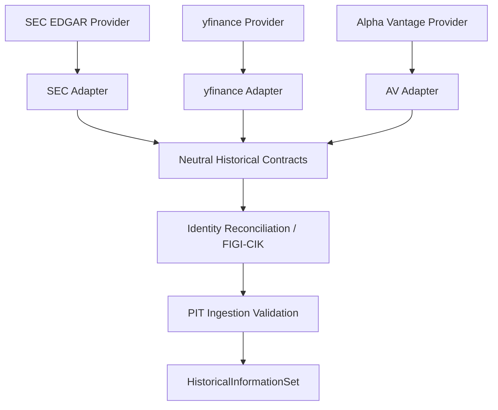

# P5-6A Historical Coverage Gap & Free-Data Expansion Audit Report

## Final Verdict

**C. LIMITED FREE DATA — PAID DATA REQUIRED FOR VALID BACKTEST**

*Verdict Rationale:*
- While SEC EDGAR provides complete point-in-time fundamentals, and Wikipedia S&P 500 history provides structured constituent metadata, **historical Daily adjusted price depth and corporate actions for fully defunct/delisted symbols (such as TWTR, SIVB) are completely missing under all evaluated free APIs.**
- Alpha Vantage's adjusted pricing and full historical time-series are restricted to the premium tier.
- yfinance returns **0 rows (empty)** for fully defunct/delisted companies.
- Reconstructing a valid, survivorship-bias-free backtesting dataset is **impossible** without paid historical market data feeds (Sharadar, Nasdaq Data Link, or Norgate).

---

## 1. Existing Production Database Audit

A direct query of the SQLite databases yields the following exact counts:

### Database: `data/historical_security.db` (Master)
- `historical_security_states`: **0 rows**
- `provider_identifiers_history`: **0 rows**
- `lifecycle_events`: **0 rows**
- `corporate_actions_history`: **0 rows**
- `universe_membership_history`: **0 rows**

### Database: `data/historical_data.db` (Facts & Prices)
- `historical_financial_facts`: **0 rows** (File not yet created in production)
- `historical_price_bars`: **0 rows** (File not yet created in production)
- `historical_corporate_actions`: **0 rows** (File not yet created in production)

### Unique Statistics Summary
- **Number of unique securities:** 0
- **Number of delisted securities:** 0
- **Number of ticker changes:** 0
- **Earliest / Latest price date:** N/A
- **Earliest / Latest financial filing:** N/A
- **Securities with both identity and price history:** 0
- **Securities with corporate actions:** 0

*Note:* `tickers.db` contains 12 active survivor index tickers used strictly for fallback and local testing.

---

## 2. Free Historical Price Sources Audit

| Provider | Daily Price Depth | Earliest Date | Latest Date | Delisted Coverage | Adjustments / Corporate Actions | PIT Safety | API Key / Auth | License / Terms |
| --- | --- | --- | --- | --- | --- | --- | --- | --- |
| **SEC EDGAR** | N/A (Facts only) | 2009 | Present | **EXCELLENT** (via CIK) | N/A | **PIT_SAFE** (filed_at) | Yes (`SEC_USER_AGENT`) | Public Domain |
| **Alpha Vantage (Free)** | Compact (100 days) | 100 days ago | Present | **METADATA_ONLY** (CSV lists 9,423 delistings) | None (adjusted is premium) | **PIT_SAFE** | Yes (`ALPHAVANTAGE_API_KEY`) | Proprietary (Limits apply) |
| **yfinance (Free)** | Full (Active Only) | Max | Present | **UNAVAILABLE** (TWTR/SIVB empty; only OTC is SBNY) | splits, dividends (Active/OTC) | **PIT_UNSAFE** (Retroactive adjustments) | No | Non-commercial |
| **Wikipedia** | N/A | 1996 | Present | **GOOD** (Metadata list) | N/A | **PIT_SAFE** | No | CC BY-SA (HTML scraper) |
| **OpenFIGI (Free)** | N/A (IDs only) | N/A | N/A | **GOOD** (FIGI mappings) | N/A | **PIT_SAFE** | Optional | Permissive (Free API) |

---

## 3. Delisted Security Price Availability

Defunct securities chosen for audit check:
1. **SIVB (Silicon Valley Bank):** yfinance returned **0 rows** of price history.
2. **TWTR (Twitter Inc.):** yfinance returned **0 rows** of price history.
3. **SBNY (Signature Bank):** yfinance returned **500 rows** of price history (trades under OTC pink sheets).

Classification:
- **Active Tickers:** `COMPLETE` (via yfinance)
- **OTC Pink Sheet Delisted Tickers:** `PARTIAL` (via yfinance)
- **Defunct Tickers (e.g. SIVB, TWTR):** `UNAVAILABLE` (metadata only available from Alpha Vantage list, prices completely missing)

---

## 4. Point-In-Time (PIT) Safety Assessment

- **SEC EDGAR:** **PIT_SAFE** — Financial snapshots can be strictly reconstructed using the `filed_at` / `accepted_at` timestamps.
- **Alpha Vantage Free:** **PIT_LIMITED** — Prices are provided by dates but lack observed timestamp logs. Full history is blocked.
- **yfinance:** **PIT_UNSAFE** — Yahoo Finance retroactively adjusts the historical price bar series upon corporate action events (splits/dividends) without maintaining an observation timestamp log, resulting in look-ahead bias if raw close is not separated and adjusted factors are not locked.

---

## 5. Provider Scorecard

| Provider | Price | Delisted | Universe | Actions | Fundamentals | PIT | Free | Identity | Verdict |
| --- | --- | --- | --- | --- | --- | --- | --- | --- | --- |
| **SEC EDGAR** | UNSUITABLE | GOOD | UNSUITABLE | UNSUITABLE | EXCELLENT | EXCELLENT | EXCELLENT | EXCELLENT | A. SEC REAL-DATA READY |
| **Alpha Vantage (Free)** | LIMITED | LIMITED | UNSUITABLE | UNSUITABLE | LIMITED | GOOD | GOOD | GOOD | B. LIMITED FREE DATA |
| **yfinance (Free)** | GOOD | UNSUITABLE | UNSUITABLE | GOOD | UNSUITABLE | UNSUITABLE | GOOD | GOOD | B. LIMITED FREE DATA |
| **Wikipedia S&P 500** | UNSUITABLE | GOOD | GOOD | UNSUITABLE | UNSUITABLE | GOOD | EXCELLENT | LIMITED | B. LIMITED FREE DATA |
| **OpenFIGI (Free)** | UNSUITABLE | GOOD | UNSUITABLE | UNSUITABLE | UNSUITABLE | EXCELLENT | EXCELLENT | EXCELLENT | B. LIMITED FREE DATA |

---

## 6. Recommended Provider Integration Architecture

Since multiple free providers must be combined, we enforce strict boundary separation:

*Architectural Invariant:* The Quant Engine and FactorEngine remain completely independent of the providers. No provider-specific structures are passed to the factors.

---

## 7. Next Gates Status

- **P5-7 (Backtester Engine):** **BLOCKED**. Gaps in defunct delisted security pricing and S&P 500 index membership history are unresolvable without paid professional datasets (Sharadar/Nasdaq Data Link or Norgate).
- **P5-8 (Predictive Validation):** **BLOCKED**. Requires complete P5-7 backtesting outputs.
